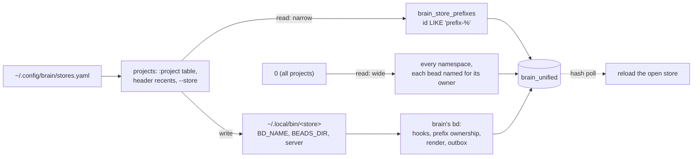

## Context

Brain is a fork of Beads that keeps many named stores on one machine. Each
store is a wrapper command (`~/.local/bin/<name>`) that pins `BD_NAME`,
`BEADS_DIR` and the Dolt server, then runs one `bd` binary. A registry,
`~/.config/brain/stores.yaml`, lists the stores. Since the switchover the
stores share one Dolt database, `brain_unified`, and a store sees only its own
namespace: the id prefixes that `brain_store_prefixes` records for it. A read
with `--wide` sees every namespace. A write with no `BD_NAME` is refused
instead of being minted under a guessed store, and brain adds checks that stock
`bd` lacks: guard hooks that can refuse a write, ownership of id prefixes,
markdown rendering and an event outbox.

b9s as built for stock Beads breaks on that in three ways:

- **It would show every store as every store.** A store's `.beads/metadata.json`
  names `brain_unified`, so b9s read the whole database for each store, 22 551
  beads on the scratch copy where `task` owns 5 729.
- **It cannot tell stores apart.** A project is identified by its Dolt host and
  database, or by its folder. Stores share both, so the header, the counts and
  the recent list treated them as one project.
- **A write would skip brain's checks.** `bd` run in a store's folder with
  `BEADS_DIR` pointing at the shared database does not apply the store's
  namespace, hooks or render root. Upstream `bd` ignores `BD_NAME` altogether.

Measured on a copy of brain's unified database (22 551 beads, 52 stores in `brain_store_prefixes`)
with brain's `bd` built from main:

- `bd count` for the task store prints 5 729. `bd list --all --json` prints
  5 563 and hides 166 gates, which `--type gate` lists; the two add up to the
  5 729 beads whose id starts with `task-` or `proto-`, the two prefixes
  `brain_store_prefixes` records for `task`.
- Brain scopes with `id LIKE '<prefix>-%'`, OR'd over the namespace's prefixes
  (`internal/storage/issueops/stale.go`, `unified_namespace.go`), after mapping
  the wrapper's name through `brain_store_aliases` and falling back to the
  store's own name when no prefix is recorded.
- The wrapper exports `BEADS_DOLT_SERVER_HOST` and `BEADS_DOLT_SERVER_PORT`. A
  store's `metadata.json` need not name the port, so b9s dialling by metadata
  alone can reach a different server than the store's `bd`.

## Decision

**When a brain registry is present, b9s runs in brain mode. The registry's
stores are its projects, a store is read through the same namespace rule brain
reads it with, and every write for a store runs through that store's own
command.**

- **Detection.** Brain mode is on when `~/.config/brain/stores.yaml` (or
  brain's legacy `~/.config/pai/stores.yaml`, or the file `BRAIN_STORES_FILE`
  names) lists a store. `--brain` and `B9S_BRAIN=on` insist on a registry,
  `--no-brain` and `B9S_BRAIN=off` ignore it, and `--store NAME` opens a store
  and implies `--brain`. A registry that exists but cannot be read is a warning
  in automatic mode, so an ordinary project still opens. Without a registry
  nothing changes: every code path of brain mode sits behind a store name that
  only the registry produces.
- **Projects.** A store is a project named for the store. `RecentProject` and
  `Project` gain a `store` field, and `SameProject` compares stores by name
  alone, so two stores on one database and one folder keep separate number
  keys, counts and reachability. `:project` lists the registry's stores.
  Started in a store's folder (or with `--store`), b9s opens that store; in any
  other folder it opens the folder as before, and the stores are one
  `:project` away.
- **Reads.** `internal/brain.Resolve` finds a store's namespace on the open
  connection with brain's rule, on every load, so a prefix claimed later is
  honoured. `DoltReader` adds the `id LIKE` clause to its issue query and its
  count. A database without `brain_unified_config` is a store on its own
  database and is read whole. A failure to resolve the namespace fails the load
  instead of reading unscoped: another store's beads shown as this store's is
  worse than none. Only the Dolt server is a source for a store. A JSONL,
  SQLite or embedded copy beside it would hold other stores' beads, so b9s does
  not fall back to one, and a reload goes through the scoped source and never a
  file.
- **Server address.** A store's sources are resolved with the variables its
  wrapper exports, read from the script without running it, before b9s's own
  environment.
- **The `0` view.** All-projects in brain mode is brain's wide read: the shared
  database once, no restriction, with each bead's `SourceRepo` set to the store
  that owns its prefix (the id prefix for a prefix no store claimed), which the
  `project:` predicate matches. The view stays read-only.
- **Writes.** `IssueWriter` runs a store's command in place of `bd`. That is
  the wrapper `~/.local/bin/<name>` when it exists and its text pins this
  store's `BD_NAME`, so a program that merely shares the name, such as a task
  runner called `task`, is never run. Without a wrapper it runs `bd` with the
  store's `BD_NAME` and `BEADS_DIR`, but only after `bd --help` shows brain's
  `--wide` flag; upstream `bd` would ignore the pins and write the shared
  database unchecked, so b9s refuses and says how to fix it. bd's output
  reaches the user unchanged, in the footer and in a popup that holds a
  refusal longer than one line, such as a guard hook's reason after its path.
- **Sources of truth stay where they were.** b9s still never writes the
  database. Brain's repository is not changed.

## Options considered

- **Read through `bd export` per store (the route ADR 0025 takes for embedded
  Dolt).** Exactly brain's own read, with nothing to keep in step: through the
  task wrapper `bd export` prints 5 730 lines, the namespace's beads with its
  gates. Rejected for the main read because it costs a process per reload, 1.4 s
  for the task store against 80 ms for the SQL read, and the reload runs on
  every write to the shared database. `bd list` is no substitute, since it
  hides gates. A contract test
  (`TestDoltIntegration_BrainReadMatchesBdsNarrowList`) compares the SQL read
  with `bd list` per store instead, so a change in brain's rule shows up as a
  failing test, not as a wrong list.
- **A different scoping rule, such as ids owned by the metadata prefix.**
  Rejected: it would disagree with `bd` about which beads a store holds.
- **Escape `_` in `LIKE` prefixes.** Not done. Brain does not, and the two
  readings must agree row for row. A prefix such as `external_llm_tasks`
  also matches a bead whose id differs only where the underscore stands; no
  such id exists on the scratch copy, and the contract test would show one.
- **Write by running plain `bd` in the store's folder.** Rejected, as above.
- **Brain mode only behind a flag.** The captain's machine has a registry and
  expects its stores; an opt-in flag would leave the default b9s showing every
  store as every store. Auto-detection with `--no-brain` is the safer default
  here, and a machine without brain is untouched.
- **Support `b9s web`.** Not now. The web server opens one project from a
  folder or database and has no store identity, so it leaves stores out of its
  header and refuses to start in a store's folder, rather than serve a store
  unscoped.

## Consequences

- A user with brain sees one project per store, with the store's own beads, in
  the header and in `:project`.
- The live reload polls the hash of the whole shared database, so a write to
  any store reloads the open store. The reload re-reads only the store's
  namespace (80 ms for the 5 730 beads of `task`).
- b9s depends on three of brain's names: the `brain_store_prefixes`,
  `brain_store_aliases` and `brain_unified_config` tables, the `id LIKE
  '<prefix>-%'` rule, and the wrapper's `export` lines and `BD_NAME` pin. A
  brain release that changes any of them is caught by the contract test and the
  wrapper tests, not by users.
- The identity registry (`b9s.identities`) and the health popup still read the
  database's plain `config` table; brain keeps a store's own configuration in
  the re-keyed `brain_unified_config` table. A store's aliases therefore do not
  appear until b9s reads that table.
- Attachments are not wired to stores; `b9s attach` and the attachment keys act
  on a store as on any checkout and are out of scope.
- Re-evaluate when brain exposes a read API that returns a store's namespace
  without a process per read, or drops `brain_store_prefixes`.
